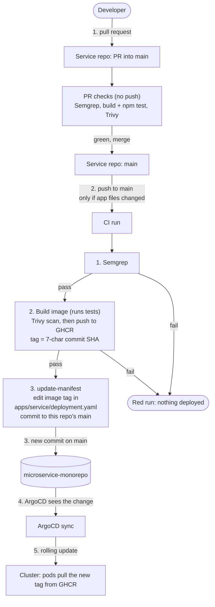
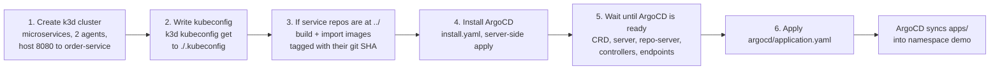

# microservice-monorepo (GitOps)

The deployment repo for three small Node.js services. It holds **only how they run** (Kubernetes manifests and the
ArgoCD Application). The application code lives in three separate repos:

| Service | Code repo | Port | Exposed as |
|---|---|---|---|
| user-service | [reynaldiekoz98/user-service](https://github.com/reynaldiekoz98/user-service) | 3001 | ClusterIP (internal) |
| product-service | [reynaldiekoz98/product-service](https://github.com/reynaldiekoz98/product-service) | 3002 | ClusterIP (internal) |
| order-service | [reynaldiekoz98/order-service](https://github.com/reynaldiekoz98/order-service) | 3003 | LoadBalancer (web UI + API gateway) |

order-service serves the web UI and forwards `/users*` and `/products*` to the other two services. It reaches them
through `USER_SERVICE_URL=http://user-service:3001` and `PRODUCT_SERVICE_URL=http://product-service:3002`.

## Layout

```
apps/
  user-service/       deployment.yaml  service.yaml
  product-service/    deployment.yaml  service.yaml
  order-service/      deployment.yaml  service.yaml   (LoadBalancer + env for the other two services)
argocd/
  application.yaml    the single ArgoCD Application (watches apps/, recursive)
scripts/
  k3d-cluster.sh      local k3s (k3d) cluster + ArgoCD: up | argocd | down
```

Plain manifests, no Helm or Kustomize. Everything is in the `demo` namespace, with 2 replicas per service.

## How it works (GitOps)

**Git is the source of truth.** ArgoCD runs in the cluster, watches the `apps/` folder of this repo and makes the
cluster match it. Nobody runs `kubectl apply` for the services. To change what runs, change a file here.

- `argocd/application.yaml` is applied **once** with `kubectl`. After that ArgoCD only syncs `apps/`.
- Sync policy is automated with **prune** (resources deleted from Git are deleted from the cluster) and
  **self-heal** (manual changes in the cluster are reverted to what Git says).
- The image tag lives in each `apps/<service>/deployment.yaml` (`image: ghcr.io/reynaldiekoz98/<service>:<sha>`).
  Tags are 7-character git SHAs, never `latest`, so every release is a visible change in Git.

## How an image update works (the full flow)

The CI half lives in each service repo (`.github/workflows/ci.yml`). The CD half is ArgoCD. CI never touches the
cluster. Its last step only writes the new tag into this repo.



Step by step:

1. **Open a PR** in a service repo. Checks run: Semgrep (code scan), a Docker build (its first stage runs
   `npm test`) and Trivy (fixable HIGH/CRITICAL vulnerabilities fail the run). Nothing is pushed.
2. **Merge to `main`.** If the merge changed app files (`index.js`, `package.json`, `src/**`, `public/**` for
   order-service, or the `Dockerfile`), the pipeline runs again and, once Semgrep and Trivy pass, pushes
   `ghcr.io/reynaldiekoz98/<service>:<sha>`. A merge that only touches docs or the workflow does not run it.
3. **Update the manifest.** The last job checks out this repo, rewrites the `image:` line for that service,
   and pushes a commit straight to `main` (message: `ci: update <service> image tag to <sha>`).
4. **ArgoCD syncs.** It sees the new commit (polls about every 3 minutes, or sync manually) and applies it.
5. **Rolling update.** Kubernetes starts pods with the new tag and retires the old ones.

If Semgrep, the tests or Trivy fail, the manifest job is skipped. This repo keeps the last good tag, and the
failed run stays red in the service repo's history.

### Rolling back

Revert the bump commit (or set the previous tag) via a PR or the bypass, and ArgoCD rolls the cluster back:

```bash
git revert <bump-commit-sha>
```

### Why CI can push to `main` here

`main` is protected by the ruleset `protect-main` (pull request required, no force-push, no deletion). The CI job
pushes directly, so the ruleset has a **bypass for the Admin role** and the job uses a fine-grained PAT that acts as
the repo admin. Side effect: you can also push directly to `main` as admin.

## Running locally (k3d + ArgoCD)

Needs `docker`, `k3d`, `kubectl` on the host. From this folder:

```bash
./scripts/k3d-cluster.sh up       # everything, in order (below)
./scripts/k3d-cluster.sh argocd   # re-apply argocd/application.yaml (after the same readiness check)
./scripts/k3d-cluster.sh down     # delete the cluster and the kubeconfig
```

What `up` does:



Settings (environment variables): `CLUSTER` (default `microservices`), `HTTP_PORT` (default `8080`),
`ARGOCD_VERSION`, `SERVICES_DIR` (default `..`), `KUBECONFIG_FILE` (default `./.kubeconfig`, gitignored).

After `up`:

```bash
export KUBECONFIG=$PWD/.kubeconfig                       # use the cluster's kubeconfig in your shell
kubectl -n argocd get applications                       # microservices should be Synced / Healthy
kubectl -n demo get pods                                 # 2 pods per service
open http://localhost:8080                               # the web UI (order-service)

# ArgoCD UI
kubectl -n argocd port-forward svc/argocd-server 8081:443     # then https://localhost:8081, user: admin
kubectl -n argocd get secret argocd-initial-admin-secret -o jsonpath='{.data.password}' | base64 -d; echo
```

Images: the cluster uses the tags in `apps/*/deployment.yaml`. If those tags match the git SHA of the service repos
checked out next to this folder, the locally built images are used. Otherwise the cluster pulls them from GHCR
(the packages must be public).

## One-time setup for the CI to work

Per service repo (user-service, product-service, order-service):

1. **GHCR package access.** GitHub profile, Packages, `<service>`, Package settings, **Manage Actions access**, Add
   Repository, pick the service repo, role **Write**. Without it the push step fails with
   `permission_denied: write_package`. Make the package public if the cluster pulls without credentials.
2. **Secret `MONOREPO_TOKEN`** on the service repo: a fine-grained PAT for `microservice-monorepo` only, with
   **Contents: Read and write**. Without write access the manifest step fails with `403 Permission denied`.

On this repo:

3. **Ruleset bypass** for the Admin role on `protect-main`:
   ```bash
   rid=$(gh api repos/reynaldiekoz98/microservice-monorepo/rulesets --jq '.[0].id')
   echo '{"bypass_actors":[{"actor_id":5,"actor_type":"RepositoryRole","bypass_mode":"always"}]}' \
     | gh api -X PUT repos/reynaldiekoz98/microservice-monorepo/rulesets/$rid --input -
   ```

## Forking this setup

To run the same pipeline under your own GitHub account (replace `YOURNAME` below):

1. **Fork or copy the four repos:** `microservice-monorepo`, `user-service`, `product-service`, `order-service`.
   Keep the names, or change them in every place listed in step 2.
2. **Change every reference to `reynaldiekoz98`.** Run this in each cloned repo, then review with `git diff`:
   ```bash
   grep -rl reynaldiekoz98 . --exclude-dir=.git | xargs sed -i 's/reynaldiekoz98/YOURNAME/g'
   ```
   The places it touches:
   | Where | What |
   |---|---|
   | `argocd/application.yaml` | `repoURL`: the Git URL ArgoCD reads |
   | `apps/*/deployment.yaml` | `image: ghcr.io/YOURNAME/<service>:<tag>` |
   | `scripts/k3d-cluster.sh` | `REGISTRY=ghcr.io/YOURNAME` |
   | each service's `.github/workflows/ci.yml` | `MONOREPO: YOURNAME/microservice-monorepo` (the image path itself uses the repo owner automatically) |
   | READMEs | links |
3. **Bot name (optional):** the manifest commit is authored as `reynaldiekoz-actions[bot]`. Change `git config user.name`
   and `user.email` in the `update-manifest` job of each `ci.yml` if you want another name.
4. **Create the image tags the manifests point at.** The tags in `apps/*/deployment.yaml` exist only in the original
   GHCR. In your fork, either merge a change in each service repo that touches app files (CI builds, pushes and
   rewrites the tag for you), or build and push once by hand and set the tag yourself:
   ```bash
   docker build -t ghcr.io/YOURNAME/user-service:v1 ./user-service && docker push ghcr.io/YOURNAME/user-service:v1
   ```
5. **Redo the one-time setup** in your account: GHCR Actions access on each package, the `MONOREPO_TOKEN` secret on each
   service repo (a PAT of *your* account), and the ruleset bypass on your monorepo. Make the packages public, or add an
   `imagePullSecret` to the Deployments.
6. **Branch protection (optional):** recreate the `protect-main` ruleset on the four repos if you want the
   pull-request-only rule.
7. **Run it:** `./scripts/k3d-cluster.sh up`. The script builds images from `../<service>` if those repos are checked
   out next to the monorepo, otherwise the cluster pulls from your GHCR.

The only assumption in the scripts is the layout: the service repos sit next to `microservice-monorepo/` (or set
`SERVICES_DIR`).

## Troubleshooting

| Symptom | Cause / fix |
|---|---|
| ArgoCD UI shows no apps | The Application was never applied. Run `./scripts/k3d-cluster.sh argocd`. |
| `ComparisonError` on the Application | ArgoCD cannot read this repo: check `repoURL` in `argocd/application.yaml` and that the repo is public. |
| `ImagePullBackOff` | The tag does not exist in GHCR, or the package is private. Check the tag in `apps/<svc>/deployment.yaml`. |
| CI: `permission_denied: write_package` | Add the repo under the package's Manage Actions access with Write (setup step 1). |
| CI: `403 Permission ... denied` on the manifest push | `MONOREPO_TOKEN` lacks Contents write, or is not scoped to this repo (setup step 2). |
| CI: `protected branch` / `Repository rule violations` | The ruleset bypass is missing (setup step 3). |
| Trivy fails the image job | Fixable HIGH/CRITICAL CVE in the base image or packages: update the Dockerfile, merge a fix. The manifest stays on the last good tag. |
| Data differs between requests | Each service keeps data in memory and runs 2 replicas, so each pod has its own copy. Use 1 replica or a shared database. |
